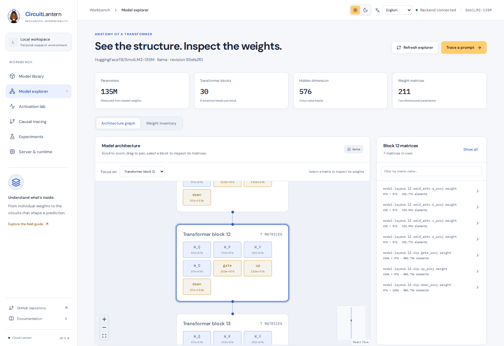
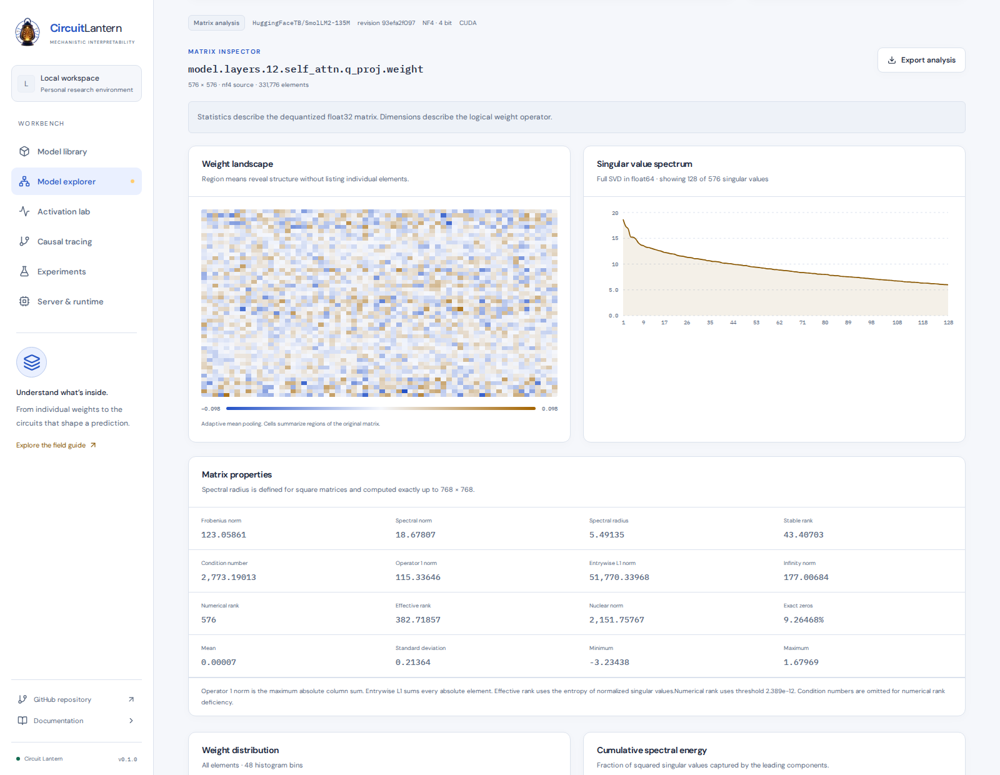
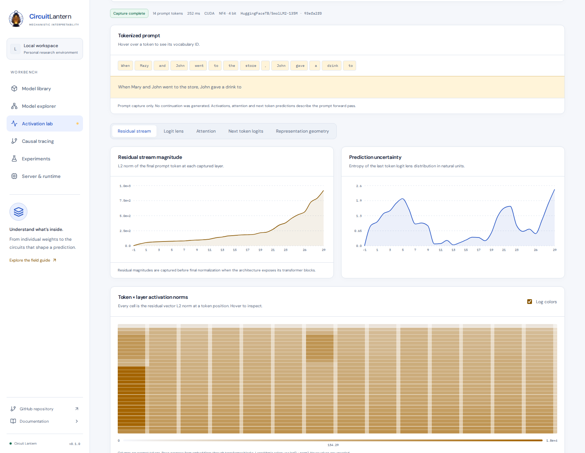
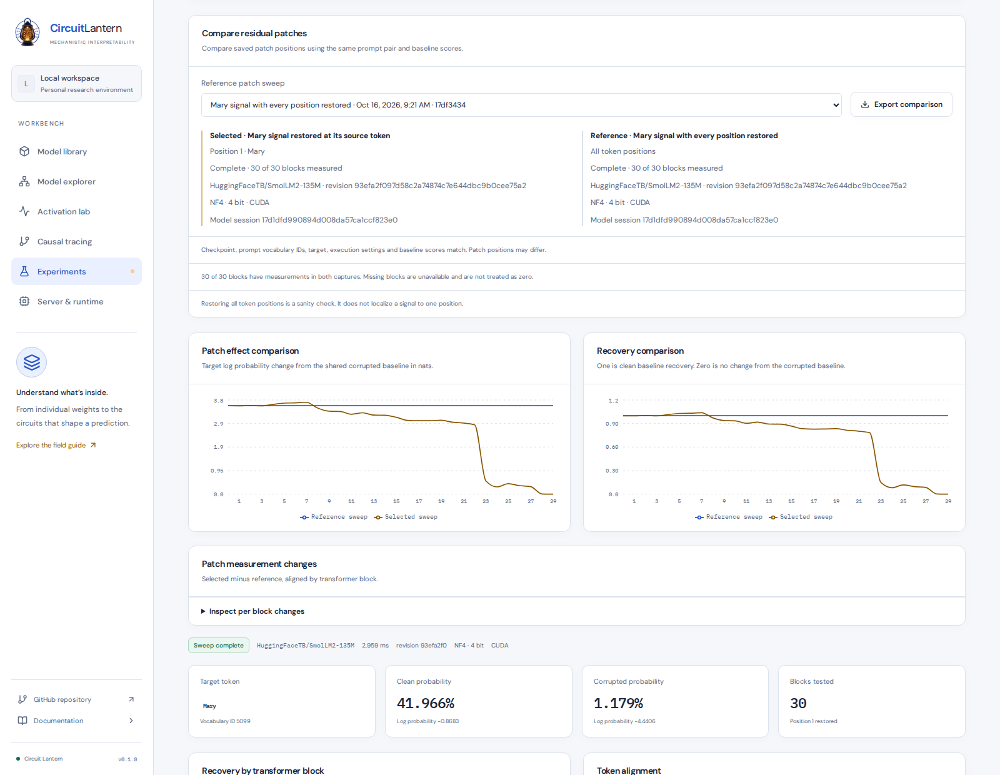

# Circuit Lantern


**A local lab for mechanistic interpretability.**

Go from a Hugging Face checkpoint to the weights, activations and interventions behind a prediction. Circuit Lantern combines a Next.js workbench with a Python backend that runs models on your own server.

Check the hardware, load a model, follow a prompt through its layers and keep the evidence in a research notebook. Choose a light or dark theme. The interface supports English, Persian, Arabic, Japanese and French, with right to left layouts for Persian and Arabic.


## What you can investigate

- **Hardware fit.** Check available RAM, VRAM, disk space, GPU architecture and execution kernels before downloading. Quantization support depends on the device and runtime, not just model size.
- **Weight geometry.** Zoom into transformer blocks, select logical matrices and inspect singular values, spectral radius, norms, rank, distributions and spectral energy.
- **Prompt traces.** Trace residual streams, token activation norms, intermediate predictions, full vocabulary confidence, entropy and attention routing. Explore individual prompt positions without another forward pass.
- **Causal interventions.** Restore clean residual activations in corrupted prompts or zero individual attention heads. Inspect target score changes, recovery and distribution divergence, with completed measurements retained when a sweep stops.
- **Research notebook.** Save traces, matrix analyses and sweeps with checkpoint revisions, execution settings and observations. Compare saved evidence and export the original records with derived measurements, even after unloading the model.

## Run locally

Requires Node.js 20.9+ and [uv](https://docs.astral.sh/uv/).

```bash
git clone https://github.com/IlyaKhalafi/CircuitLantern.git
cd CircuitLantern
make install
make dev
```

For NVIDIA GPUs, use `make install-cuda` instead of `make install`.

Open [localhost on port 3000](http://localhost:3000). Start with **SmolLM2 135M** or **Pythia 70M**. The tiny random GPT-2 checkpoint is useful for checking the workflow, but its predictions have no linguistic meaning.

## Inside the lab



| Deployment checks | Weight geometry |
| --- | --- |
| [](docs/images/deployment-check.png) | [](docs/images/weight-analysis.png) |
| Check the selected device, execution format and memory budget. | Explore structure and spectra without a wall of individual numbers. |
| **Residual streams** | **Causal comparisons** |
| [](docs/images/activation-lab.png) | [](docs/images/causal-comparison.png) |
| Follow a prompt through the model's captured internal states. | Compare patch positions against a shared baseline and keep the source evidence. |

Screenshots use a trained SmolLM2 135M checkpoint. Open any preview for the full image.

## Know what you are measuring

Intermediate logit lens predictions are diagnostic projections. Attention patterns describe routing and do not establish causal importance. Matrix analyses distinguish exact measurements from spectral estimates, and missing results remain unavailable.

Execution supports FP32, FP16, BF16, bitsandbytes NF4, native bitsandbytes FP4 checkpoints and LLM.int8 on supported CPU or CUDA paths. Native FP8 and NVFP4 analysis adapters remain pending. NVFP4 requires Blackwell hardware as well as a compatible runtime.

## Go further

- [Setup](docs/setup.md) covers CUDA installation, configuration and remote access.
- [Measurements](docs/measurements.md) explains capture conventions, interventions and comparisons.
- [Development](docs/development.md) covers checks and browser verification.
- [Architecture](docs/architecture.md) describes the service boundaries and current limits.

Contributions should keep the workflow focused, preserve measurement provenance and include useful verification.
