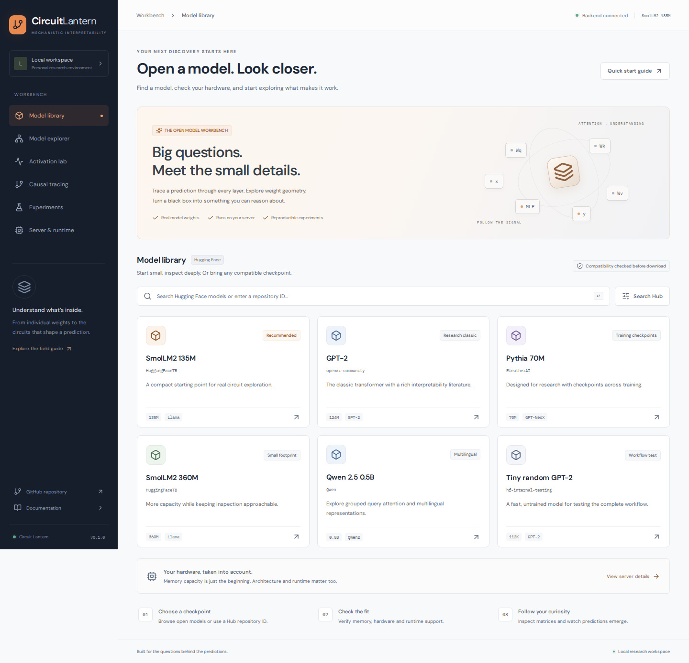
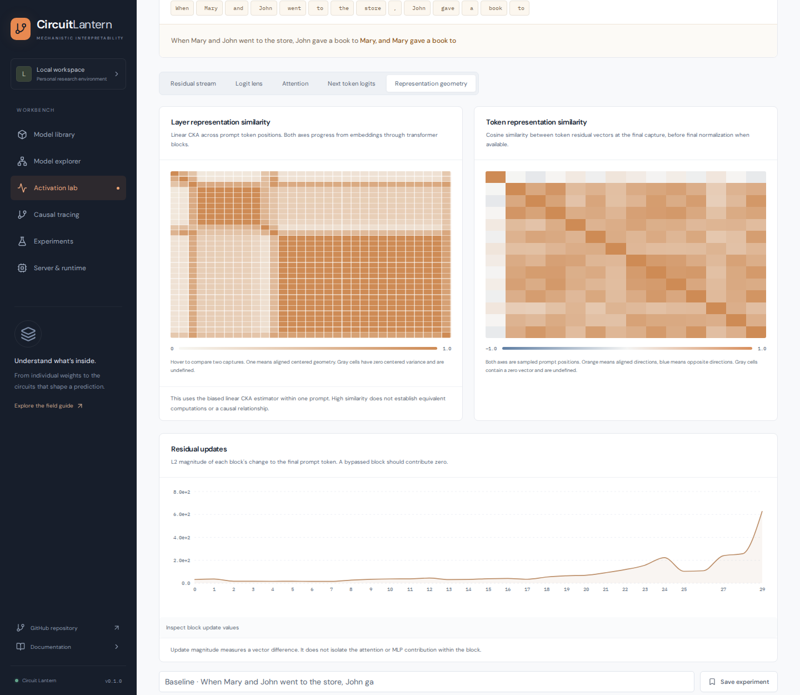

# Circuit Lantern

**An open workbench for understanding what happens inside a language model.**

Choose a Hugging Face checkpoint, check whether your server can run it, and move from model structure to weight geometry to live activation traces in one place.

Circuit Lantern runs locally with a Next.js frontend and a Python backend. Model weights and experiment records stay on your server.



## What you can explore

- **Hardware aware model selection** using available RAM, free VRAM, disk space, GPU compute capability and tested runtime kernels
- **Selectable execution formats** with FP32, FP16, BF16, bitsandbytes NF4 and LLM.int8, including packed checkpoint loading and logical matrix inspection
- **Interactive architecture graphs** with pan, zoom, transformer block selection and a searchable weight inventory
- **Weight geometry** with pooled heatmaps, singular value spectra, cumulative energy, norms, spectral radius, stable rank, condition numbers, distributions and sparsity
- **Live activation traces** with prompt tokens, residual stream norms, layer predictions, next token logits and attention patterns
- **Representation geometry** with layer CKA, token cosine similarity and block residual update magnitudes
- **Causal interventions** with transformer block bypass, a baseline residual overlay and clean to corrupted activation patching across every block
- **Experiment notebooks** with local SQLite persistence, editable observations and portable JSON exports

<details>
<summary>See weight analysis and live activation captures</summary>

These screenshots use NF4 execution of the trained SmolLM2 135M checkpoint at revision `93efa2f097d58c2a74874c7e644dbc9b0cee75a2`.




</details>

## Run locally

You need Node.js 20.9 or newer, [uv](https://docs.astral.sh/uv/), and enough memory for the model you want to inspect. The default Python installation uses CPU PyTorch so the complete workflow also works without a GPU.

```bash
git clone https://github.com/IlyaKhalafi/CircuitLantern.git
cd CircuitLantern
make install
make dev
```

For an NVIDIA server, use `make install-cuda` instead of `make install`. It uses uv to select a CUDA wheel for the installed driver and verifies device availability. Set `TORCH_BACKEND=cu128` when you need a specific supported wheel family. The development commands preserve the installed PyTorch build. Running `uv sync` directly restores the CPU lockfile, so rerun the CUDA installation target afterward. See [uv PyTorch backend selection](https://docs.astral.sh/uv/guides/integration/pytorch/#automatic-backend-selection).

Open [localhost on port 3000](http://localhost:3000). The API runs on port 8000 and exposes its schema at [the API documentation](http://localhost:8000/docs).

Start with **SmolLM2 135M** or **Pythia 70M** for research. Use **Tiny random GPT-2** for a quick workflow check. The tiny checkpoint is untrained and its predictions do not have linguistic meaning.

## A first investigation

1. Select a model in the library and review its deployment report.
2. Download the checkpoint and explore the architecture graph.
3. Select a weight matrix and inspect its spectrum and distribution.
4. Open the activation lab and trace a short prompt.
5. Run the same prompt with one transformer block bypassed.
6. Save both traces as experiments and record your observations.
7. Open causal tracing to restore clean residual outputs in a corrupted prompt and measure target recovery across layers.

## Compatibility is more than memory

Checkpoint size alone is insufficient. Native NVFP4 execution requires Blackwell hardware. An H100 or H200 does not gain native FP4 support by having enough VRAM. Software kernels and the analysis runtime must also support the checkpoint format.

The runtime accepts supported Transformers causal language models in safetensors. Choose FP32, FP16, BF16, bitsandbytes NF4 or LLM.int8 execution. Auto preserves a supported packed checkpoint format and otherwise selects FP32. Unquantized sources can be converted to NF4 or int8 while loading. Existing bitsandbytes checkpoints keep their quantization configuration. Native FP8 and NVFP4 analysis adapters remain pending even on eligible hardware.

NF4 and bitsandbytes FP4 are different from native NVFP4. CPU and CUDA quantization paths are checked with real kernel probes. CUDA NF4 requires Pascal or newer, while LLM.int8 requires Turing or newer. CPU fallback execution reduces weight storage but does not guarantee faster inference. The CPU NF4 runtime retains canonical packed weights and uses float32 compute, avoiding the shape restrictions and mutable storage of the AVX512 BF16 repacker.

The memory report accounts for the selected weight format, unquantized embeddings and output heads, residual capture, bounded attention, a conservative KV cache allowance and temporary float32 matrix space. Source checkpoint download size remains unchanged when selecting on-load quantization. Logical parameter counts come from a model initialized on meta tensors, avoiding packed byte counts. The report reserves 15 percent of currently available memory. Concurrent workloads can change availability before loading. CUDA checks use the first device visible to PyTorch and respect CUDA_VISIBLE_DEVICES. Multi GPU sharding is not implemented.

On Linux, RAM budgets honor readable cgroup v1 and v2 memory constraints for the backend process and its parents. The budget considers shared parent usage and reclaimable inactive file cache, then applies the same memory reserve. A known limit with unreadable usage cannot claim available capacity. This prevents container deployments from being assessed using the host RAM total alone. See the [kernel memory controller documentation](https://docs.kernel.org/admin-guide/cgroup-v2.html#memory).

See [Transformers bitsandbytes support](https://huggingface.co/docs/transformers/quantization/bitsandbytes), [bitsandbytes hardware compatibility](https://huggingface.co/docs/bitsandbytes/installation), [NVIDIA NVFP4 documentation](https://docs.nvidia.com/deeplearning/transformer-engine/features/low_precision_training/nvfp4/nvfp4.html) and [Transformers fine grained FP8 requirements](https://huggingface.co/docs/transformers/quantization/finegrained_fp8) for native hardware requirements.

## Measurement conventions

Graphs report logical matrix dimensions. Packed bytes are never treated as weight values. Quantized matrix analysis dequantizes the selected matrix to float32. A converted GPT-2 Conv1D operator uses the equivalent Linear weight orientation, which transposes its displayed dimensions. Trace, causal and matrix exports record the execution precision, effective quantization configuration, execution device and library versions.

Full matrix norms and descriptive statistics use all elements. Spectral analysis uses exact SVD for matrices with dimensions up to 768 and randomized SVD on the full matrix for larger weights, retaining 64 components with four power iterations. Approximate spectral norms and stable ranks are labeled. Cumulative spectral energy uses the full matrix squared Frobenius norm as its denominator. Condition numbers are reported only for exact spectra. Heatmap cells are adaptive region means. Spectral radius is computed exactly for square matrices up to 768 × 768.

The logit lens applies final normalization and the model unembedding to intermediate hidden states. Its intermediate probabilities are diagnostic projections and should not be treated as calibrated confidence. The final residual magnitude is captured before normalization through a block hook for supported architectures. Interactive captures accept at most 128 prompt tokens. The attention view includes a head average, mean query entropy per head, and each head's routing from the final prompt token. A head routing table reports the strongest key position and final query entropy. The final query measure is separate from entropy averaged over every prompt position. Attention captured in a bypassed block is labeled because its output is replaced after the block computes.

The representation geometry tab uses biased linear CKA across prompt token positions to compare centered layer representations. It also shows final capture token cosine similarity and each block's residual update norm, full prompt update RMS and update to input norm ratio. These are diagnostics within one prompt. High similarity does not establish equivalent or causal computation. CKA is undefined with fewer than three sampled positions or zero centered variance. Cosine similarity is undefined for zero vectors. Geometry uses at most 128 evenly spaced prompt positions and exports their original indices. Residual update statistics use every prompt position. See [Kornblith and colleagues on representation similarity](https://proceedings.mlr.press/v97/kornblith19a.html).

## Causal tracing

Use clean and corrupted prompts with the same number of tokens. Choose a single target token or use the clean model's most likely next token. A sweep runs separate corrupted forward passes, each restoring the clean residual output at one transformer block. Restore the last token, every token, or one explicit position.

The report includes baseline probabilities, token alignment, per block target log probabilities and normalized recovery. Recovery divides the change from the corrupted log probability by the clean to corrupted difference. Values may be negative or exceed one. Recovery is undefined when corruption does not lower the target log probability by more than 0.001 nats. Small positive score gaps are flagged for cautious interpretation. Restoring all positions is a sanity check rather than a localization measurement. It should recover the clean computation for the supported decoder architectures when masks and token positions match.

Sweeps run in the background with per layer progress and cancellation. Page refreshes and navigation reconnect to the latest sweep in the same browser session, including completed results and their original inputs. Export results as JSON before restarting the backend. Current sweep jobs are ephemeral.

## Configuration

Copy [.env.example](.env.example) to `backend/.env` as needed. Never commit access tokens.

| Variable | Default | Purpose |
| --- | --- | --- |
| `LANTERN_DATA_DIR` | `data` | Experiment database directory |
| `LANTERN_MAX_MODEL_BYTES` | `21474836480` | Maximum checkpoint download size |
| `LANTERN_MAX_PROMPT_TOKENS` | `128` | Interactive prompt capture limit |
| `HF_TOKEN` | unset | Access to gated Hugging Face repositories |
| `LANTERN_BACKEND_URL` | `http://127.0.0.1:8000` | Backend address read by the Next.js server at runtime |

Hugging Face downloads use the standard Hub cache. Download storage checks measure that cache filesystem, separately from experiment database storage. Configure `HF_HOME` to move it. The default lockfile selects the CPU index. The CUDA installation target replaces only the environment PyTorch build using driver aware selection. The server page reports whether CUDA is actually available in Python.

Both services bind to loopback by default. This is a personal research workstation with no authentication. Use a private SSH tunnel for remote access. Add authentication and deployment controls before exposing it to an untrusted network.

## Development

```bash
make test
make check
make build
make test-ui
```

Browser verification uses a deterministic local GPT-2 fixture with real safetensors weights and a local tokenizer. It builds a temporary frontend snapshot with the installed dependencies, preserving running production builds and generated files in the working tree. It starts an isolated backend and a production Next.js server, then exercises model loading, graph navigation, weight statistics, traces, patching, persistence, exports, accessibility and mobile layouts. It needs no Hub account or model download. Install the browser once with `cd web && npx playwright install chromium`. Test services use ports 8011 and 3110 by default and refuse to reuse running services. Override `LANTERN_TEST_BACKEND_PORT` and `LANTERN_TEST_WEB_PORT` if needed.

The backend separates Hub access, hardware discovery, compatibility, model execution, numerical analysis and experiment storage into services. Model operations are serialized to keep hooks and weights consistent. Downloads run as background jobs. A failed download preserves the active model. Loading a replacement releases the previous model first to avoid holding two checkpoints in memory, so a later loading failure leaves no model active. Only safetensors checkpoints are accepted and remote model code is disabled.

Contributions should keep the researcher workflow focused, document measurement assumptions, and include checks for numerical or runtime changes. See [the architecture notes](docs/architecture.md).
