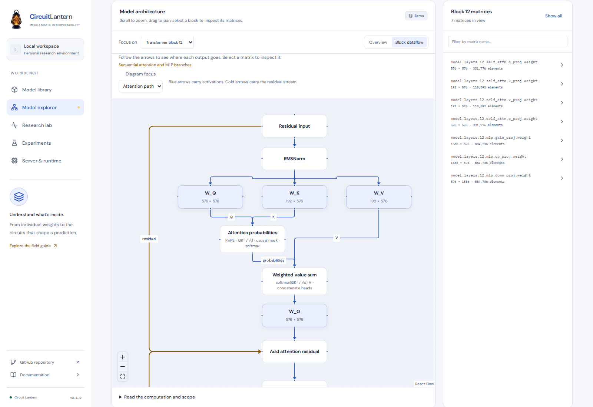
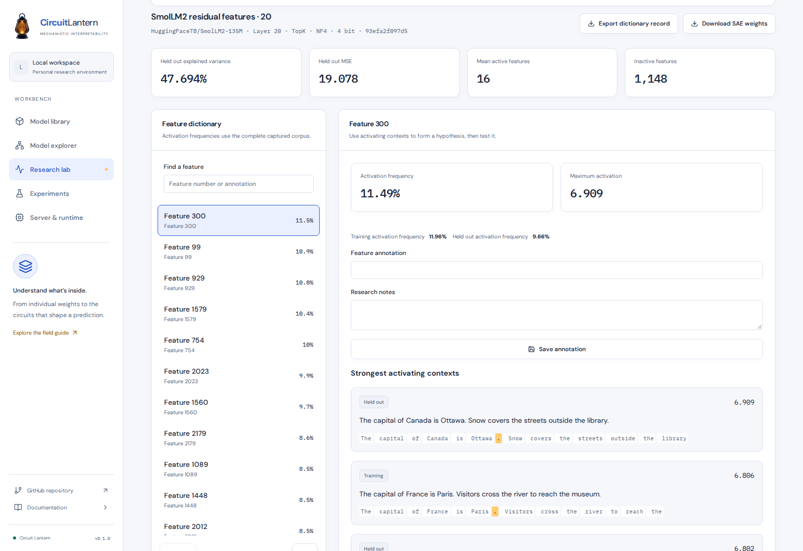
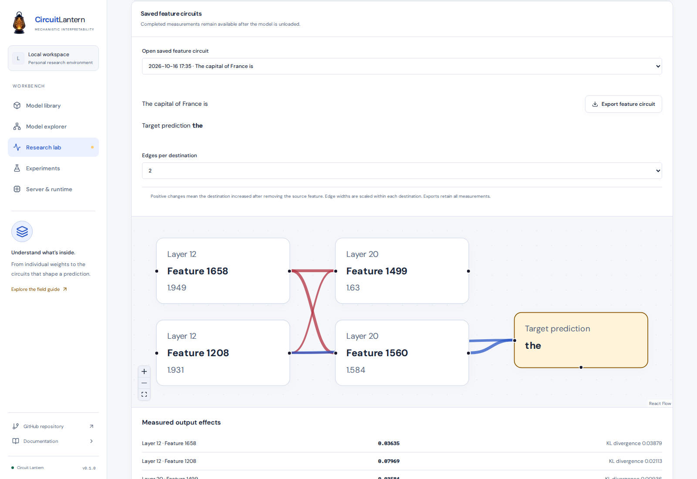
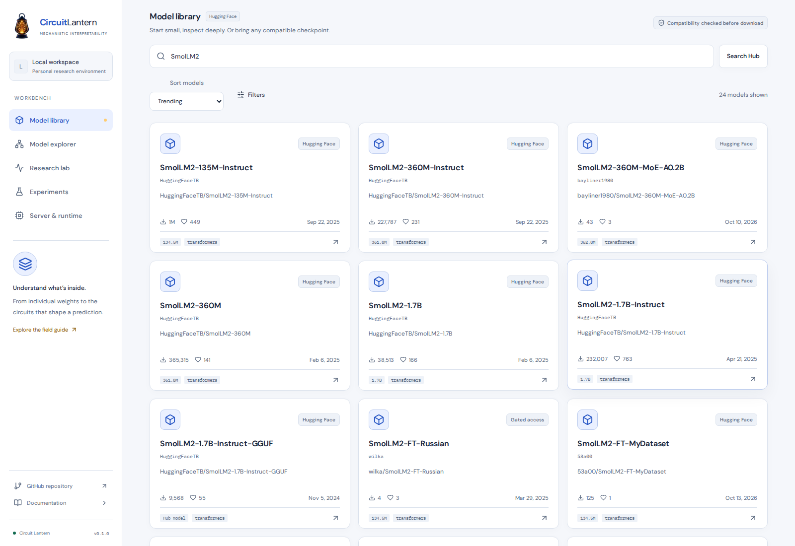
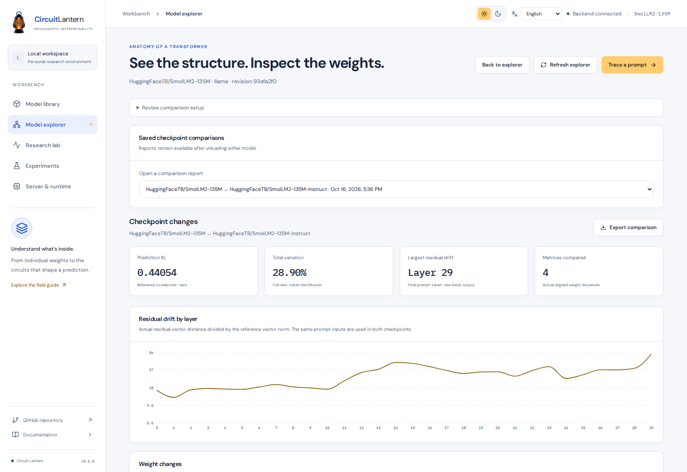

<div align="center">

<p align="center">
  
</p>

<h1 align="center">Circuit Lantern</h1>

<p align="center"><strong>Illuminate the inner workings of language models.</strong></p>

<p align="center">
A local lab for mechanistic interpretability.<br />
Explore weights, trace activations and test what changes a prediction.
</p>

<p align="center">
<a href="#run-locally">Get started</a> &nbsp;·&nbsp;
<a href="#what-you-can-investigate">Features</a> &nbsp;·&nbsp;
<a href="#inside-the-lab">Gallery</a> &nbsp;·&nbsp;
<a href="docs/setup.md">Documentation</a>
</p>

<p align="center">
<sub>Next.js + Python &nbsp;·&nbsp; Light and dark themes</sub><br />
<sub>English &nbsp;·&nbsp; فارسی &nbsp;·&nbsp; العربية &nbsp;·&nbsp; 日本語 &nbsp;·&nbsp; Français</sub>
</p>

</div>

<picture>
  <source media="(prefers-color-scheme: dark)" srcset="docs/images/workbench-dark.png" />
  <source media="(prefers-color-scheme: light)" srcset="docs/images/workbench-light.png" />
  
</picture>

## What you can investigate

- **Model discovery.** Browse Hugging Face models by trending score, downloads, likes or recency. Narrow the results by author, date window and popularity.
- **Hardware fit.** Check RAM, VRAM, disk space, GPU architecture and execution kernels before downloading. Quantization support depends on the device and runtime, not just model size.
- **Weight geometry.** Follow attention, MLP and residual connections inside transformer blocks. Select logical matrices to inspect singular values, spectral radius, norms, rank, distributions and spectral energy.
- **Prompt traces.** Follow residual streams, intermediate predictions, vocabulary confidence, entropy and attention routing. Explore captured token positions without another forward pass.
- **Checkpoint changes.** Compare a base model with a finetuned version using retained weights, layer activations and final output distributions. Keep both revisions and execution settings with the results.
- **Sparse features.** Train ReLU or TopK sparse autoencoders from a text corpus. Inspect held out reconstruction, activating contexts and feature interventions, then save graphs of measured downstream effects.
- **Causal interventions.** Residual patching reports target score changes and normalized recovery. Attention head ablation reports target score changes and KL divergence. Repeated token probes investigate candidate induction heads. Completed measurements remain available when a sweep stops.
- **Research notebook.** Save traces, matrix analyses and sweeps with checkpoint revisions, execution settings and observations. Compare saved evidence and export the source records after unloading the model.

## Run locally

Requires Node.js 20.9+ and [uv](https://docs.astral.sh/uv/).

```bash
git clone https://github.com/IlyaKhalafi/CircuitLantern.git
cd CircuitLantern
make install
make dev
```

For NVIDIA GPUs, use `make install-cuda` instead of `make install`.

Open [localhost on port 3000](http://localhost:3000). Start with **SmolLM2 135M** or **Pythia 70M**. The tiny random GPT-2 checkpoint is useful for checking the workflow, but its predictions have no linguistic meaning.

For Docker with explicit GPU access, run `python3 scripts/deploy.py --gpus 0 --port 9001`. Use `--gpus 0,1` to expose a device list. See [Docker setup](docs/setup.md#docker-deployment) for details.

## Inside the lab



[Model overview](docs/images/model-explorer.png) · [MLP connections](docs/images/block-dataflow-mlp.png) · [Dark theme](docs/images/block-dataflow-dark.png)

| Deployment checks | Weight geometry |
| --- | --- |
| [](docs/images/deployment-check.png) | [](docs/images/weight-analysis.png) |
| Check the selected device, execution format and memory budget. | Explore structure and spectra without a wall of individual numbers. |
| **Residual streams** | **Causal comparisons** |
| [](docs/images/activation-lab.png) | [](docs/images/causal-comparison.png) |
| Follow a prompt through the model's captured internal states. | Compare patch positions against a shared baseline and retain the evidence. |
| **Sparse dictionaries** | **Feature circuits** |
| [](docs/images/sparse-features.png) | [](docs/images/feature-circuit.png) |
| Inspect learned directions, examples and reconstruction quality. | Test a feature hypothesis through interventions and saved output effects. |
| **Hub discovery** | **Checkpoint comparison** |
| [](docs/images/hub-trending.png) | [](docs/images/checkpoint-comparison.png) |
| Find a checkpoint using familiar rankings and focused filters. | Measure weight, residual and prediction changes between model versions. |

Measurements shown here use trained SmolLM2 135M base and instruct checkpoints. Screenshots capture a normal viewport with the complete sidebar. Open any preview for the full image.

## Know what you are measuring

Intermediate logit lens predictions are diagnostic projections. Attention patterns describe routing and do not establish causal importance. Feature circuit edges measure downstream ablation effects, not direct causal connections. Checkpoint comparisons assume aligned model coordinates. Matrix analyses distinguish exact measurements from estimates, and missing results remain unavailable.

Execution supports FP32, FP16, BF16, bitsandbytes NF4, native bitsandbytes FP4 checkpoints and LLM.int8 on supported CPU or CUDA paths. Native FP8 and NVFP4 analysis adapters remain pending. NVFP4 requires Blackwell hardware as well as a compatible runtime.

## Go further

- [Setup](docs/setup.md) covers CUDA installation, configuration and remote access.
- [Measurements](docs/measurements.md) explains capture conventions, interventions and comparisons.
- [Sparse features](docs/features.md) covers dictionary training, validation, interventions and research references.
- [Checkpoint comparisons](docs/checkpoints.md) explains retained references, alignment checks, model drift and block dataflow.
- [Development](docs/development.md) covers checks and browser verification.
- [Architecture](docs/architecture.md) describes the service boundaries and current limits.

Contributions should keep the workflow focused, preserve measurement provenance and include useful verification.
