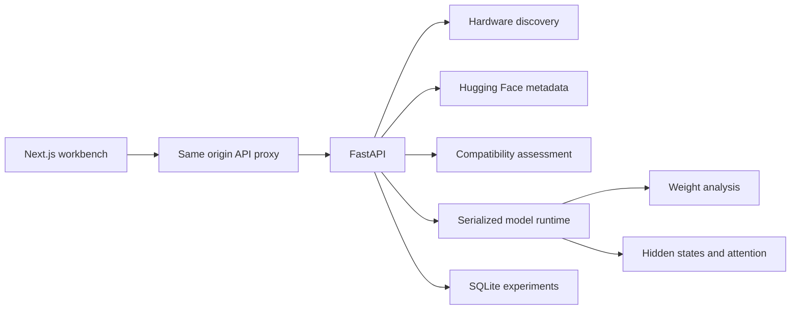

# Architecture

Circuit Lantern is a personal research workstation with two local processes.

## Backend boundaries

`hardware.py` observes the server without changing GPU state or disturbing other workloads. `hub.py` resolves model metadata and immutable checkpoint revisions. `compatibility.py` is a pure decision function, making hardware requirements testable without a GPU or network.

`runtime.py` owns one model and tokenizer. Its operation lock serializes loading, unloading, matrix analysis and activation capture. Download workers update bounded in memory job records. Weight statistics use a small cache that is cleared whenever the model changes.

`metrics.py` holds numerical calculations and declares the difference between exact statistics and randomized full matrix spectral estimates. `store.py` uses short SQLite transactions with a connection per operation.

## Frontend boundaries

The App Router separates the library, architecture explorer, activation lab, experiments, server and field guide. Shared components cover the shell, panels, charts, heatmaps and trace results. API types and formatting utilities live in `src/lib`.

The frontend calls a same origin API path. Next.js forwards requests to the Python service so browser requests do not need a separate backend origin.

## Current limits

- One model and one execution device per backend process
- Float32 analysis of unquantized safetensors causal language models
- No execution of custom repository code
- Model download jobs are ephemeral and do not survive a backend restart
- Saved experiment traces are durable in SQLite
- GPU eligibility does not imply packed quantization inspection support
- No authentication or multi tenant isolation

Large model execution, distributed workers and packed weight adapters should retain these boundaries rather than adding format specific behavior to the API routes or the interface.
