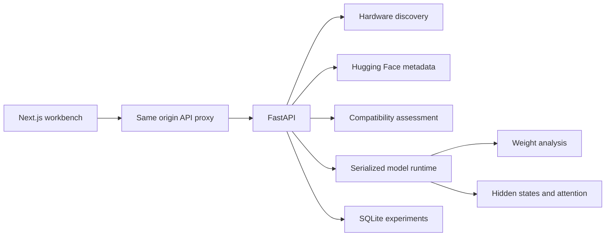

# Architecture

Circuit Lantern is a personal research workstation with two local processes.

## Backend boundaries

`hardware.py` observes resources and runs tiny execution probes on the first visible CUDA device. It does not change device configuration or manage other workloads. `hub.py` resolves model metadata and immutable checkpoint revisions. `compatibility.py` is a pure decision function, making hardware requirements testable without a GPU or network.

`architecture.py` derives logical parameter and quantizable weight counts from a model on meta tensors. `execution.py` resolves precision, probes kernel support and builds loading options. `weights.py` translates supported packed storage into logical matrices for analysis.

`runtime.py` owns one model and tokenizer. Its operation lock serializes loading, unloading, matrix analysis and activation capture. Download workers update bounded in memory job records. Weight statistics use a small cache that is cleared whenever the model changes.

`metrics.py` holds numerical calculations and declares the difference between exact statistics and randomized full matrix spectral estimates. `store.py` uses short SQLite transactions with a connection per operation.

## Frontend boundaries

The App Router separates the library, architecture explorer, activation lab, experiments, server and field guide. Shared components cover the shell, panels, charts, heatmaps and trace results. API types and formatting utilities live in `src/lib`.

The frontend calls a same origin API path. A Next.js route handler forwards requests to the Python service so browser requests do not need a separate backend origin. It reads the backend address at runtime, allowing the same production build to target a different server without rebuilding.

Causal sweeps run in the same serialized executor as model loading. A sweep captures clean block outputs once, then runs one restored block per corrupted forward pass. The model revision is checked before execution and cannot be replaced by another background load during the sweep. Cancellation is cooperative between layers, preserving completed results. Browser job polling survives navigation and detects expired job IDs after a server restart.

Fonts are bundled with the frontend so rendering does not depend on third party font requests.

## Current limits

- One model and one execution device per backend process
- FP32, FP16, BF16, bitsandbytes NF4 and LLM.int8 execution
- Float32 statistics on loaded or dequantized logical matrices
- Native FP8 and NVFP4 adapters remain pending
- No execution of custom repository code
- Model download jobs are ephemeral and do not survive a backend restart
- Saved experiment traces are durable in SQLite
- GPU eligibility does not imply packed quantization inspection support
- No authentication or multi tenant isolation

Large model execution, distributed workers and additional packed weight adapters should retain these boundaries rather than adding format specific behavior to the API routes or the interface.
