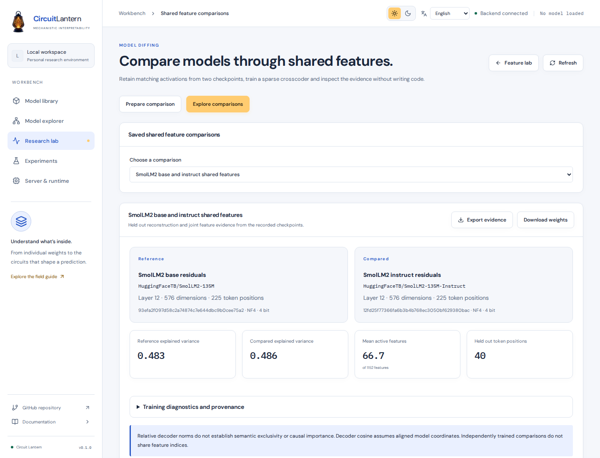

# Shared feature comparisons

A sparse crosscoder learns one set of latent features from two activation captures. Each feature has a shared activation and a separate decoder direction for each checkpoint. This gives a common feature space for studying a base model and a finetuned version.

Open **Research lab**, choose **Feature lab**, then **Compare shared features**. The existing checkpoint comparison in the model explorer remains useful for weight deltas, residual drift and output distributions.

<picture>
  <source media="(prefers-color-scheme: dark)" srcset="images/shared-feature-comparison-dark.png" />
  
</picture>

Example run with SmolLM2 135M base and instruct in NF4 at layer 12. The dictionary used 128 optimizer steps, 225 paired positions and 40 held out positions.

[Explore joint feature contexts and decoder geometry](images/shared-feature-explorer-dark.png)

## Prepare the captures

1. Load the reference checkpoint from the model library.
2. Choose one transformer layer and provide 4 to 256 documents, one per line. Record the reference activations.
3. Return to the model library and load the checkpoint to compare.
4. Return to the comparison workspace and refresh. Record matched activations at the desired layer.
5. Check the two recorded sources before training.

The matched capture reuses the reference documents, token limit, sampling rules and split seed. The backend compares exact model inputs, token positions and dataset split fingerprints before running the second model. A larger context window still uses the effective reference token limit. Different tokenization or a smaller limit that changes the model inputs is rejected.

Capture uses the residual stream immediately after the selected transformer block. Special tokens and the first sequence position are excluded by default. Advanced settings expose these choices, the sample limit and the split seed. Existing corpus preparation separates document groups before training and excludes repeated sampled prefixes across splits.

Every capture action checks resources before starting a teacher forward. The token control follows the loaded checkpoint's context allowance and the server limit. Resource plans show the effective token limit and warn about documents that will be truncated. Saved capture summaries retain the effective limit and truncation count. Document length validation counts Unicode code points.

Both captures remain on the server after the model is unloaded. You can also select two distinct existing captures with matching fingerprints. The sources can have different residual widths, although decoder cosine is unavailable for different widths.

## Train and inspect

Choose a comparison name and a training device. CPU training is always available. GPU training uses the first CUDA device exposed to the lab through its deployment GPU list.

Resource checks estimate additional RAM, VRAM and disk use with the currently loaded model left resident. You can unload that model before training. Training reads retained activations and never updates source model weights.

Advanced settings expose expansion, optimizer steps, sparsity penalty, batch size, learning rate and random seed. The default sparsity penalty is 0.05. A larger penalty trades reconstruction quality for fewer active features. Validate this tradeoff on a corpus appropriate to your research question.

The explorer includes

- Held out explained variance and raw mean squared error for each checkpoint
- Joint feature frequency, mean active feature count and reconstruction history
- Relative decoder norms and decoder cosine where defined
- Activating token contexts with their training or held out split
- Feature labels, research notes, ranking, search and pagination

Stopping a capture discards incomplete activation rows. Stopping training after at least one completed optimizer step retains a partial dictionary and records the completed step count. Its metrics describe that partial dictionary.

## What the measurements mean

Each activation bank is divided by its training-only RMS L2 vector norm. A zero scale uses one. Learned per-bank centering starts at the geometric median of training activations.

The shared ReLU encoder sums contributions from both banks. The objective adds per-sample squared normalized L2 reconstruction error across banks and a sparsity term. That term weights each shared feature activation by the **sum of its individual decoder column norms**. A norm over concatenated decoder vectors would be a different objective.

Decoder columns have joint unit norm at initialization and remain unconstrained during optimization. Independently forcing every bank direction to unit length would erase the relative norm differences being measured.

Held out explained variance compares squared reconstruction error with a constant predictor fitted to each bank's training mean. Raw MSE remains in the original activation units.

Decoder shares use normalized bank units. They do not establish that a concept exists exclusively in one model. Features can be dense or polysemantic. Decoder cosine additionally assumes that model coordinates are aligned. Independently trained crosscoders do not share feature indices.

This implementation follows the joint representation learning formulation in [Sparse Crosscoders for Cross-Layer Features and Model Diffing](https://transformer-circuits.pub/2024/crosscoders/index.html). The [2025 model diffing update](https://transformer-circuits.pub/2025/crosscoder-diffing-update/index.html) discusses limitations of model-exclusive features and a reduced penalty variant for designated shared features. That variant is not implemented here.

## Retain and export evidence

Each capture records its checkpoint revision, execution identity, precision, layer, residual width and corpus fingerprint. Each comparison retains both capture sources, preprocessing scales, training means, hyperparameters, split evidence, diagnostics and method references.

**Export evidence** downloads the immutable comparison manifest together with current annotations. **Download weights** downloads the joint encoder and decoder banks as safetensors. Tensor and manifest checksums are verified independently. Labels and notes are stored separately and do not change the immutable manifest checksum.

Tensor and weight downloads are checked before the browser starts receiving bytes. Missing files, integrity failures and busy storage appear beside the controls so you can retry. Verified files stream directly to the browser without being copied into a large browser memory buffer. A prepared download expires after one minute if it has not started. A download that has started continues from its verified file even if the source artifact is deleted.

Use **Manage retained data** to export capture metadata and tensors or delete saved artifacts. Deleting a source capture leaves existing comparison evidence available. Training another comparison requires its activation captures to remain available.

## Storage recovery

A damaged summary does not hide healthy captures or comparisons. The affected record appears under **Manage retained data** with its identifier and an integrity warning. It is excluded from research selection and can still be deleted without bypassing tensor or manifest checks for normal reads and exports.

On startup, complete tensor files without matching database records move to the storage directory's recovery folder. They are preserved rather than deleted. Recovery files alone do not include the immutable manifest and cannot reconstruct a scientific capture without its original database. Back up artifacts.sqlite3 together with its tensor files.
