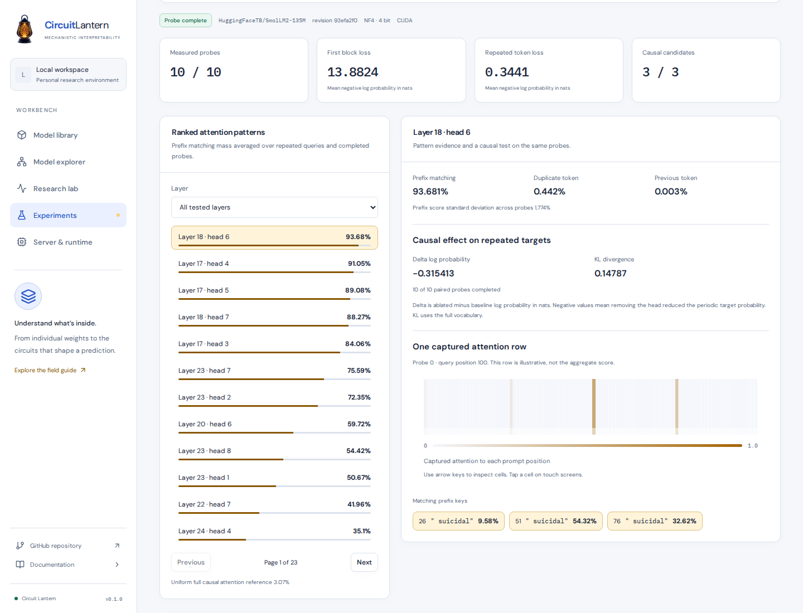

# Repeated token head probes

Circuit Lantern can look for candidate induction heads without writing a notebook. Open **Research lab**, choose **Causal tracing**, then **Head ablation** and **Explore induction heads**.

The probe follows the repeated token experiments in [In-context Learning and Induction Heads](https://transformer-circuits.pub/2022/in-context-learning-and-induction-heads/index.html). It measures attention patterns and tests selected heads through actual output ablation. A high pattern score is evidence for a hypothesis about a head, rather than proof of its function.

[Loss across repeats](images/induction-repeat-loss.png) · [Mobile inspector](images/induction-head-mobile.png)

## Run a probe

Load a supported checkpoint and open the induction probe. The recommended block length and repeat count adapt to the active context allowance and tokenizer vocabulary.

Choose **Check resources** to inspect the additional memory budget without running the teacher. Choose **Run probe** to check resources and start measurement. The same exact token sequences are reused for baseline and intervention runs.

The default configuration samples ten blocks of 25 distinct nonspecial token IDs. Each block repeats four times. The configured beginning of sequence token is prepended when available. Advanced settings let you change block length, repeats, example count, random seed and selected layers.

Only the highest scoring candidate heads receive causal tests. Set the candidate count to zero to collect attention patterns alone. With `E` examples and `K` selected candidates, a complete probe uses `E × (1 + K)` forward passes. The baseline output distributions are retained on CPU and reused.

Cancellation takes effect between forward passes. Completed examples and paired ablations remain available. A partially measured head reports its own completed example count. Failed captures retain earlier complete measurements and the location of the failure.

## Read the results

**Prefix matching** measures attention to keys whose preceding token matches the current query token. For a sequence `A B C A`, the last `A` has a matching prefix at the earlier `B`. The expected periodic next token is `B`.

**Duplicate token** measures attention to earlier occurrences of the query token itself. **Previous token** measures attention to the immediately preceding position.

All three scores average over the same query positions after the first block, then over completed probe examples. The prefix standard deviation describes variation between these probe examples. It is a population standard deviation over the captured examples, rather than a confidence interval.

The uniform full causal attention reference averages the fraction of available keys that match the prefix at each measured query. It is a descriptive reference distribution, rather than a significance threshold or a model of attention with sliding windows.

Selecting a head reveals one captured attention row from the first complete probe at the final prompt position. Its token positions and matching prefix keys are shown separately from the aggregate head score.

The loss chart reports mean negative log probability in nats for each repeat. Every scored position has a known next token in the periodic sequence, including the final prompt position. The beginning of sequence position is excluded from these losses.

## Test causal effects

Each candidate query head is independently zeroed at every input position before its attention output projection. This keeps the intervention aligned with the verified concatenated head layout, including models with shared key and value heads.

The target change is the ablated mean periodic target log probability minus its unchanged baseline. A negative value means removing the head reduced the target probability. Positive values mean it increased the target probability.

KL divergence measures the baseline distribution against the ablated distribution over the complete output vocabulary, averaged over the repeated query positions. Both metrics are then averaged over completed paired examples for that head.

Candidate ranking and causal tests use the same synthetic probe examples. These are intervention measurements on the sampled inputs, rather than held out generalization results. Zero ablation can produce activations outside the model's usual distribution.

## Preserve the evidence

Save the result to **Experiments** to keep it after unloading the model. Notebook records support names, observations, filtering and JSON export. Renaming a record or editing its observations leaves the captured evidence unchanged.

The export retains exact input IDs, periodic target IDs, scored query positions, vocabulary pool checksum, local random seed and dataset fingerprint. It also includes the checkpoint revision, execution precision and configuration, per-probe losses, head scores, paired causal effects and method details.

The sampler uses a local CPU random generator. It does not change the application's global random state. Token IDs pass directly to the model without decoding and retokenizing.

## Supported execution

Verified eager attention layouts currently cover GPT-2, Llama, Qwen2 and GPT-NeoX. Unsupported or pruned attention layouts are rejected before a probe runs. Runtime context limits, available RAM, visible GPU memory and saved evidence disk space are checked before allocation and again in the worker.

| Setting | Allowed values |
| --- | --- |
| Tokens per block | 4 to 64 |
| Repeats | 2 to 4 |
| Probe examples | 1 to 32 |
| Candidate heads to ablate | 0 to 12 |
| Pattern heads per probe | Up to 8192 |

The implementation validates captured probabilities against their storage precision, rejects nonfinite or noncausal patterns, then normalizes and accumulates attention in float64. Log probabilities and KL use float64 calculations on the model's actual output logits.

A production integration check on the pinned SmolLM2 135M base checkpoint in NF4 on an H200 used ten 25-token blocks, four repeats and seed 19. Layer 18 head 6 had a prefix score of approximately 0.9368. Its mean target log probability change under ablation was approximately −0.3154 nats. The run verified unchanged teacher weights, removed intervention hooks and retained notebook evidence after unloading. These observations apply to that checkpoint, execution and synthetic sample.

## Method boundaries

The paper filters token sampling by frequency. Circuit Lantern instead samples uniformly from distinct nonspecial IDs in the shared input and output vocabulary. This adaptation can include unusual token sequences.

The [TransformerLens head detector](https://github.com/TransformerLensOrg/TransformerLens/blob/main/transformer_lens/head_detector.py) provides a useful reference for the shifted duplicate token mask. Circuit Lantern averages only over repeated query positions, so its aggregation differs from a whole-pattern attention mass ratio.

The paper's OV copying score is a separate quantity. Circuit Lantern reports prefix attention and full-model ablation effects, and does not label either as that copying score.

Pattern matching does not establish copying, semantic function, causal necessity across prompts or a mechanism for general in-context learning.
