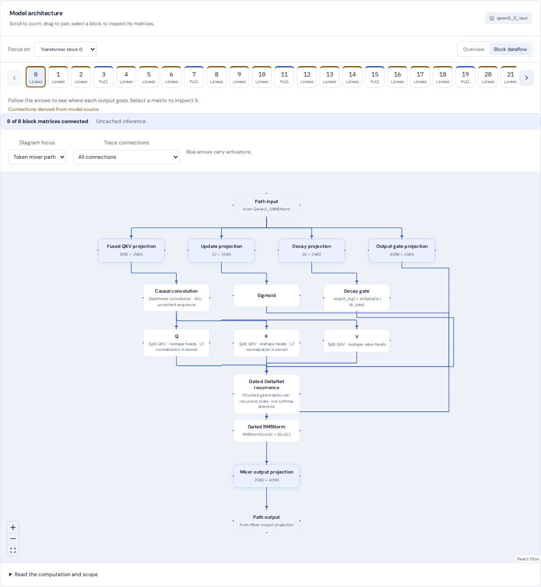
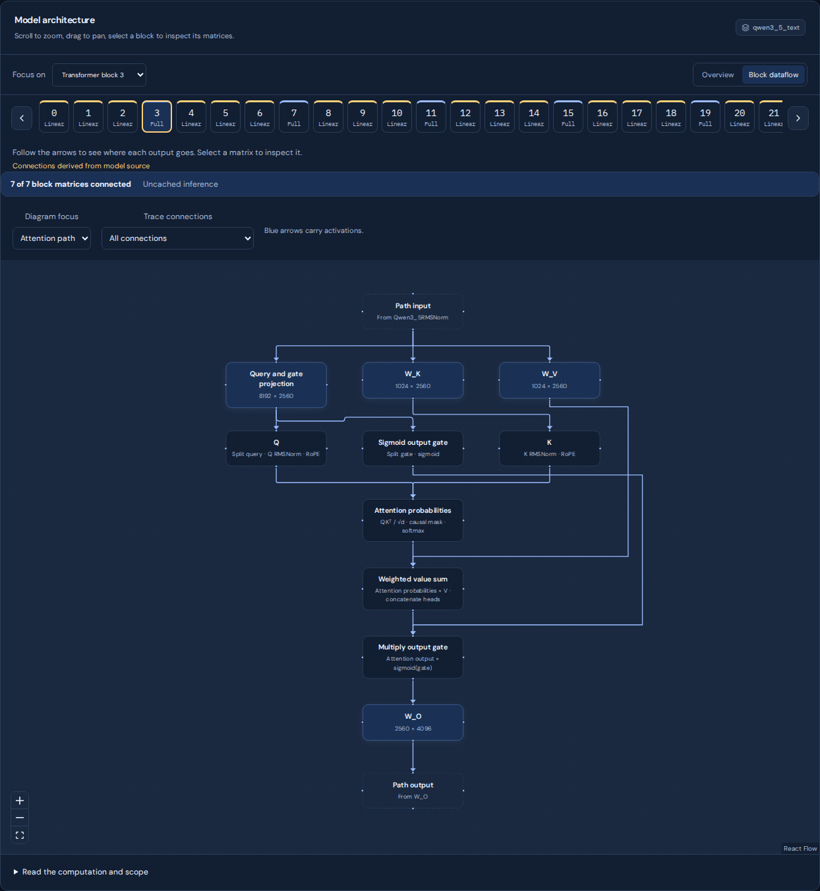

# Model explorer

Open **Block dataflow** to follow activations through a transformer block. Matrix boxes open the corresponding logical weights, including supported quantized weights. Gold arrows mark proven residual shortcuts. **Trace connections** highlights the upstream and downstream paths of one operation.

Focused paths show explicit input and output boundary values. Operations outside the selected path stay outside the diagram. Select **Full block** to include normalization and residual connections around both sublayers.

Use the previous and next buttons to browse layers. When a layer chip has keyboard focus, arrow keys move between layers and Home or End jumps to either end. The selected path remains active when changing layers, and the layer strip scrolls without moving the page.

For hybrid Qwen 3.5 models, the layer strip distinguishes Gated DeltaNet layers from full attention layers. Select a layer to see its actual mixer. The DeltaNet diagram includes QKV projection, causal convolution, update and decay gates, recurrence, gated normalization and the output projection. The full attention diagram includes the joint query and gate projection, query and key normalization, rotary position encoding, attention probabilities and the sigmoid output gate.

These panels show actual weights from `hamishivi/Qwen3.5-4B`. Focused views keep their complete input and output values visible on desktop. On narrow screens, pan the graph or use the zoom controls.

## How connections are discovered

Existing curated diagrams remain available for GPT-2, GPT-NeoX, Llama, Mistral, Qwen2 and Qwen3. Other block classes use a bounded parser of the installed `forward` source. It follows registered module calls, assignments, additions, multiplication and branches resolved from primitive configuration values. It does not connect matrices by their names or registration order.

Simple child modules expand recursively. Dynamic control flow and unavailable source remain summarized. Each source-derived diagram reports the number of matrices linked to operations, and lists weights whose internal connections remain unresolved. These weights are still inspectable. Coverage counts refer to two dimensional logical weights, rather than every parameter or operation in a model.

Qwen 3.5 uses verified mixer diagrams for its kernel operations, with surrounding block and MLP connections derived from source. Other tested families include Gemma, Gemma2, Gemma3 text, Phi, OLMo, OLMo2, StarCoder2, Granite, BLOOM and GPT-J. Their coverage varies. A supported block-level diagram does not imply that every mixer has been expanded.

## Scope

The diagrams describe module dependencies and summarized inference operations for the full sequence without a KV cache. They are not execution traces, attention measurements or causal attribution. Hooks, decorators, kernel dispatch and custom wrappers can change execution. Tensor layout operations and one dimensional normalization parameters may be summarized. DeltaNet recurrence crosses token positions and is not a softmax attention map.

Building a diagram runs no model forward pass and reads no checkpoint tensor values. Parsed source is cached with bounded capacity. Unsupported constructs stop expansion at a module boundary rather than guessing its wiring.

The [Transformers Qwen 3.5 documentation](https://huggingface.co/docs/transformers/model_doc/qwen3_5) describes its hybrid decoder and gated mixers. The installed implementation is the source of truth for the selected model runtime.
